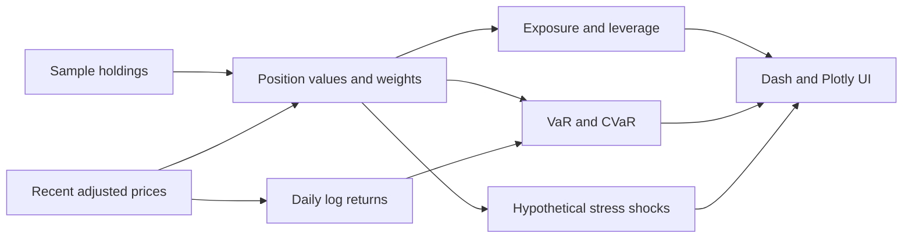

# Portfolio Risk Dashboard

An interactive Python and Dash prototype for exploring the exposure and one-day risk of a simulated multi-asset portfolio.

At startup, the application downloads two years of recent adjusted market prices, calculates portfolio analytics, and presents them in a Plotly dashboard. It is an educational analytics project, not investment advice or a production risk engine.

## Features

- Fixed sample portfolio spanning equities, a bond ETF, and a commodity ETF
- Market value, position weight, asset-class exposure, and sector exposure
- Historical, Gaussian parametric, and simulated one-day Value at Risk (VaR)
- Historical Conditional VaR / Expected Shortfall
- Gross and net leverage for the long-only sample portfolio
- Hypothetical stress-scenario P&L
- Cumulative-return, distribution, exposure, stress, and position views

## How it works



## Risk methods

- **Historical VaR:** percentile of the observed portfolio-return series.
- **Parametric VaR:** Gaussian quantile using the observed portfolio mean and standard deviation.
- **Simulated VaR:** 10,000 draws from a univariate normal distribution fitted to the portfolio-return series.
- **CVaR / Expected Shortfall:** average observed portfolio return at or below the historical VaR threshold.
- **Stress tests:** explicitly defined hypothetical asset-class shocks. Their labels are illustrative; they are not historical event replays.

## Run locally

```bash
python -m venv .venv
source .venv/bin/activate
pip install -r requirements.txt
python dashboard.py
```

Open `http://127.0.0.1:8050`.

The application requires internet access at startup to request market data from Yahoo Finance.

## Configure the sample portfolio

Edit `PORTFOLIO` near the top of `dashboard.py` to change tickers, share counts, asset classes, or sectors. Edit `STRESS_SCENARIOS` to define different hypothetical shocks.

## Repository structure

```text
dashboard.py       Analytics and Dash application
requirements.txt   Runtime dependencies
README.md          Project documentation
```

## Important assumptions and limitations

- Holdings and stress shocks are hard-coded examples.
- Prices are downloaded when the application starts; the dashboard is not a streaming or real-time market-data system.
- The simulation draws from a fitted portfolio-level normal distribution. It is not a multivariate asset-path simulation.
- VaR and CVaR are backward-looking estimates and can understate tail risk.
- Cumulative returns are reconstructed from daily log returns with exponential compounding.
- There is no persistence layer, authentication, automated test suite, continuous integration, or deployment configuration.
- Results are for software demonstration and education only, not financial advice.
